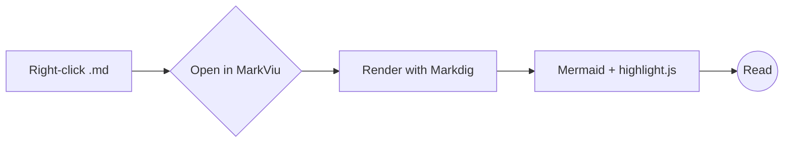
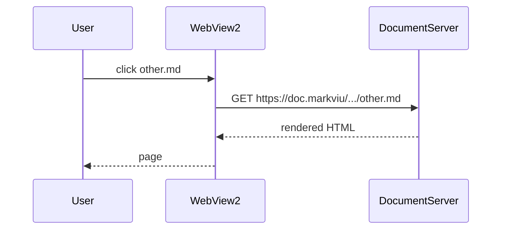
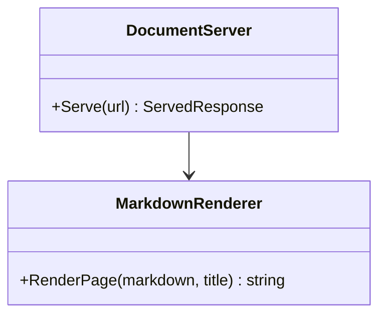

# MarkViu Sample

A tour of what MarkViu renders. Edit and save this file while it is open: the view refreshes on its own.

## Contents

- [Links](#links)
- [Code](#code)
- [Mermaid diagrams](#mermaid-diagrams)
- [Tables and task lists](#tables-and-task-lists)

## Links

| Kind | Link |
|---|---|
| Another document | [other.md](other.md) |
| Heading in another document | [other.md#second-section](other.md#second-section) |
| Document in a subfolder | [sub/page.md](sub/page.md) |
| Name with spaces | [My Notes (draft).md](<sub/My Notes (draft).md>) |
| A folder (README or listing) | [sub/](sub/) |
| Plain text file (opens in default app) | [notes.txt](notes.txt) |
| Web page (opens in browser) | [github.com](https://github.com) |
| Broken link | [missing.md](missing.md) |


## Code

```csharp
public static string FromPath(string path)
{
    var full = Path.GetFullPath(path);
    return $"https://doc.markviu/{full}";
}
```

```javascript
const greet = (name) => `Hello, ${name}!`;
console.log(greet('MarkViu'));
```

## Mermaid diagrams







This one is intentionally invalid:

```mermaid
flowchart TD
    A --> 
    this is not valid ))
```

## Tables and task lists

- [x] Render markdown
- [x] Navigate links
- [ ] Take over the world

| Feature | Status |
|---|:---:|
| Mermaid | ✅ |
| Syntax highlighting | ✅ |
| Live reload | ✅ |

> **Tip:** Alt+← and Alt+→ go back and forward. Ctrl+F searches the page.
